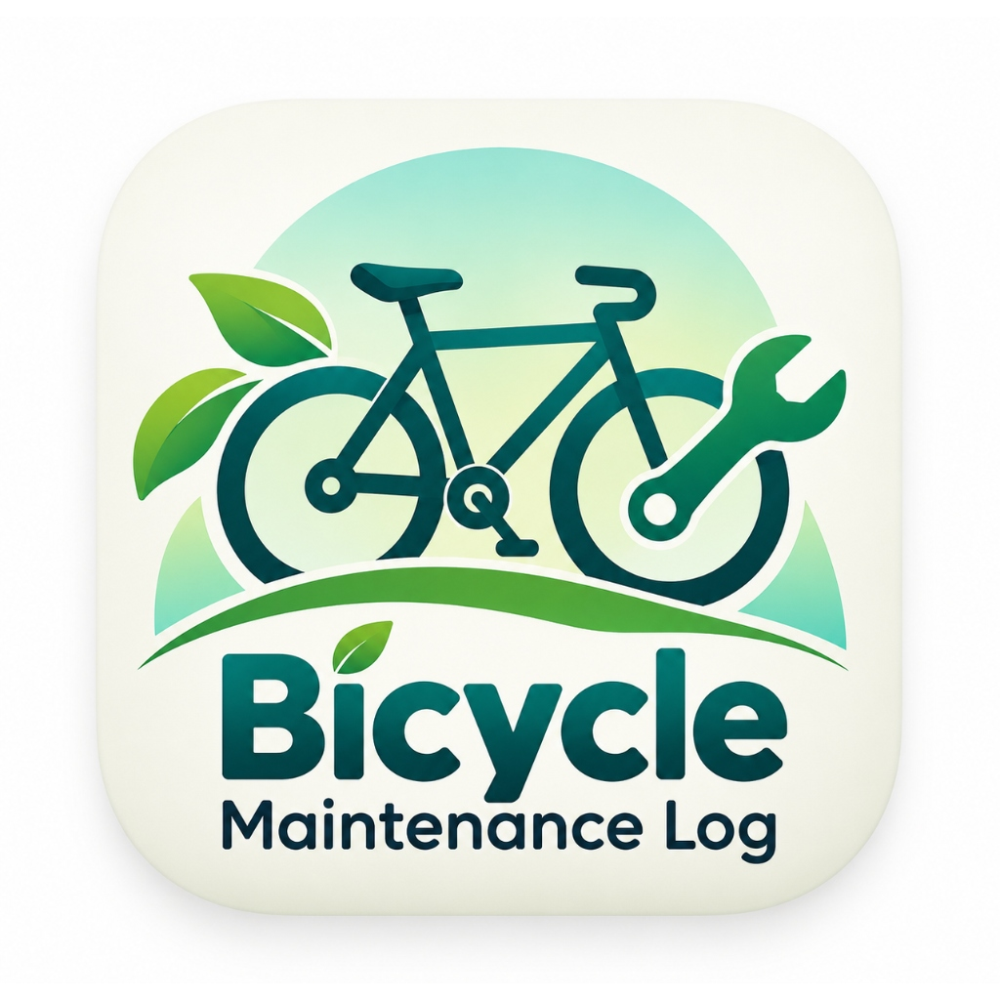

<div align="center">

  

  # Bicycle Maintenance Log
  ### *Ride Smart. Maintain Better.*

  [](https://flutter.dev)
  [](https://dart.dev)
  [](https://m3.material.io/)
  [](https://sdgs.un.org/goals/goal11)
  [](https://github.com/Praneeth2711/bicycle-maintenance-log)
  [](#)

</div>

---

## 📋 Academic Evaluation Information

| Detail | Information |
| :--- | :--- |
| **Student Roll Number** | `24PA1A05I0` |
| **Project Title** | Bicycle Maintenance Log |
| **Academic Focus** | B.Tech Computer Science & Engineering – Flutter Mobile Application Evaluation |
| **Sustainable Development Goal** | **SDG 11:** Sustainable Cities and Communities |
| **Repository** | [https://github.com/Praneeth2711/bicycle-maintenance-log](https://github.com/Praneeth2711/bicycle-maintenance-log) |
| **Application Version** | `1.0.1` (Version Code: `2`) |

---

## 🎯 1. Project Overview

The **Bicycle Maintenance Log** is a colorful, clean, offline-first Flutter application developed to help bicycle commuters and cycling enthusiasts keep their bicycles in dependable condition. By actively tracking services, maintenance expenditures in Indian Rupees (₹), and upcoming scheduled servicing, this application empowers users to maintain their bicycles reliably, promoting sustainable and eco-friendly urban transportation.

### Core Value Proposition
- **Fleet Management:** Register and manage multiple bicycles with brand, model, and purchase date.
- **Service Logging:** Record maintenance tasks (Lubrication, Tyre Changes, Brake Adjustments, Cleaning, General Servicing) with cost validation.
- **Dynamic Reminders:** In-app status categorization (**Upcoming**, **Due Today**, **Overdue**) based on exact calendar date matching.
- **Financial Tracking:** Real-time cumulative maintenance expenses in Indian Rupees (`₹`).
- **100% Offline-First:** Fully persistent local data storage using `shared_preferences` without external server dependencies.

---

## 🌍 2. SDG Alignment: Goal 11 (Sustainable Cities & Communities)

> **"Regular bicycle maintenance encourages safe, sustainable, and eco-friendly transportation."**

* **Sustainable Urban Mobility:** Well-maintained bicycles encourage daily cycling commutes, directly reducing reliance on fossil-fuel motor vehicles and curbing urban carbon emissions.
* **Safety & Reliability:** Timely brake tuning, chain lubrication, and tyre inspections prevent on-road failures and accidents.
* **Affordability & Inclusivity:** Preventive maintenance lowers the total cost of ownership, making cycling an economical, resilient commute option for students and citizens.

*(Note: In accordance with academic guidelines, this project avoids exaggerated claims and does not simulate synthetic carbon emission formulas.)*

---

## ✨ 3. Application Screenshots & Key Features

### 1. Home Dashboard
- **Custom Brand Header:** Professional branding with custom app logo and slogan *"Ride Smart. Maintain Better."*
- **Overview & Statistics Cards:** Pastel-coded overview cards displaying Total Bicycles, Total Maintenance Records, and Total Expenses in Indian Rupees (`₹`).
- **SDG 11 Contribution Card:** Highlights urban sustainability principles.
- **Upcoming Service Preview:** Nearest scheduled bicycle service with real-time status badge (**Upcoming** / **Due Today**).
- **Quick Action Buttons:** Fast shortcuts to register a bicycle or log maintenance with a single tap.

### 2. My Bicycles (Fleet Management)
- Complete CRUD (Create, Read, Update, Delete) capability.
- Form validation requiring bike name, brand, model, and purchase date picker.
- **Cascade Deletion:** Deleting a bicycle automatically purges its associated maintenance records to prevent orphaned data.
- Friendly, custom empty-state illustration when no bicycles are registered.

### 3. Maintenance History
- All maintenance events displayed in chronological order (**latest records first**).
- Reusable maintenance cards displaying service type, bicycle name, date, cost in ₹, and detailed notes.
- Quick edit and delete actions with confirmation dialogs.

### 4. Service Reminders
- Filters records with explicitly scheduled **Next Service Dates**.
- Calendar-date accuracy (avoids timestamp hour/minute miscalculations).
- Status Rules:
  - 🟢 **Upcoming (Green):** Future scheduled service dates.
  - 🟠 **Due Today (Orange):** Services scheduled for today.
  - 🔴 **Overdue (Red):** Past service dates requiring immediate attention.
- In-place reschedule and edit button.

---

## 🎨 4. Design System & Color Palette

Designed using **Material Design 3** with high-contrast, accessible typography and curated color tokens:

| Token Name | Hex Code | Visual Swatch | Usage |
| :--- | :--- | :---: | :--- |
| **Primary** | `#009688` |  | AppBars, primary buttons, active tabs |
| **Secondary** | `#42A5F5` |  | Maintenance action buttons, secondary highlights |
| **Accent / Expenses** | `#FFB74D` |  | Expense stat cards, warning accents |
| **Accent Purple** | `#9575CD` |  | Notes and category tags |
| **Background** | `#F8FAFC` |  | Scaffolds, soft neutral canvas |
| **Status Upcoming** | `#43A047` |  | Green badge for future services |
| **Status Due Today**| `#FB8C00` |  | Orange badge for today's services |
| **Status Overdue**  | `#E53935` |  | Red badge for overdue services |

---

## 📂 5. Clean Architecture & Directory Structure

```text
bicycle-maintenance-log/
│
├── android/                        # Android native configurations & launcher icons
├── assets/
│   └── images/
│       └── app_logo.png            # 1024x1024 high-resolution custom logo
│
├── lib/
│   ├── main.dart                   # Application entry, Material 3 theme, IndexedStack tabs
│   │
│   ├── models/
│   │   ├── bicycle.dart            # Bicycle data model (JSON serialization)
│   │   └── maintenance.dart        # MaintenanceRecord model with safe date parsing
│   │
│   ├── screens/
│   │   ├── home_screen.dart        # Screen 1: Dashboard with logo header & SDG 11 card
│   │   ├── bicycle_list_screen.dart# Screen 2: My Bicycles list with CRUD operations
│   │   ├── add_bicycle_screen.dart # Screen 3: Add / Edit bicycle form
│   │   ├── history_screen.dart     # Screen 4: Chronological maintenance history
│   │   ├── add_maintenance_screen.dart # Screen 5: Add / Edit maintenance form
│   │   └── reminders_screen.dart   # Screen 6: Color-coded service reminders
│   │
│   ├── services/
│   │   └── storage_service.dart    # SharedPreferences offline persistence layer
│   │
│   ├── utils/
│   │   └── app_colors.dart         # Color palette tokens & badge styling constants
│   │
│   └── widgets/
│       ├── app_logo.dart           # Reusable custom logo container widget
│       ├── bicycle_card.dart       # Reusable bicycle card with action buttons
│       ├── maintenance_card.dart   # Reusable maintenance history entry card
│       └── stat_card.dart          # Reusable overview statistics card
│
├── test/
│   └── widget_test.dart            # 6 comprehensive test suites (Models, CRUD, Heroes, Scenarios)
│
├── pubspec.yaml                    # Dependencies, asset registrations, launcher icon config
└── README.md                       # Comprehensive documentation
```

---

## 🛠️ 6. Getting Started & Installation

### Prerequisites
- [Flutter SDK](https://docs.flutter.dev/get-started/install) (v3.24.0 or newer)
- [Dart SDK](https://dart.dev/get-dart) (v3.5.0 or newer)
- Android Studio / VS Code with Flutter extension
- USB Debugging enabled Android device or Android Emulator

### Installation Steps

1. **Clone the repository:**
   ```bash
   git clone https://github.com/Praneeth2711/bicycle-maintenance-log.git
   cd bicycle-maintenance-log
   ```

2. **Fetch dependencies:**
   ```bash
   flutter pub get
   ```

3. **Verify code quality:**
   ```bash
   flutter analyze
   ```
   *(Expected output: `No issues found!`)*

4. **Run automated test suite:**
   ```bash
   flutter test
   ```
   *(Expected output: `All tests passed!`)*

5. **Run on an Android device or emulator:**
   ```bash
   flutter run
   ```

6. **Build Release APK:**
   ```bash
   flutter build apk --release
   ```
   Output binary: `build/app/outputs/flutter-apk/app-release.apk`

---

## 🧪 7. Automated Test Suite

The test suite in [`test/widget_test.dart`](test/widget_test.dart) tests:
1. **Model Tests:** `toJson()` and `fromJson()` for `Bicycle` and `MaintenanceRecord`.
2. **Safe Deserialization:** Verification that missing or malformed `nextServiceDate` strings parse safely as `null` without crashing.
3. **Storage & Cascade Deletion:** Adding bicycles and maintenance records, calculating total expenses, and verifying cascade deletion when a bicycle is removed.
4. **Hero Collision Verification:** Verifies all `FloatingActionButton` widgets inside `IndexedStack` have distinct `heroTag` values.
5. **Full Lifecycle Scenario:**
   - Registers bicycle named `"Road"`.
   - Records maintenance with date `17 Oct 2026` and next service `29 Oct 2026`.
   - Verifies dashboard and reminders display `"Upcoming"`.
   - Verifies persistence across simulated app restart.
   - Edits next service date and verifies synchronization across screens.
   - Deletes record and verifies reminder vanishes with `"No upcoming services scheduled."` displayed.

---

## 📊 8. College Evaluation Rubric Compliance

| Rubric Criteria | Project Implementation | Evaluation Status |
| :--- | :--- | :---: |
| **Student Roll Number** | `24PA1A05I0` documented in README, test suites, and project submission | ✅ Complete |
| **Branding & Professional UI** | Custom logo, launcher icons, subtitle `"Ride Smart. Maintain Better."` | ✅ Complete |
| **SDG 11 Alignment** | Dedicated card emphasizing sustainable cities and community cycling | ✅ Complete |
| **Currency Requirement** | Indian Rupee (`₹`) formatted across all expense statistics and cards | ✅ Complete |
| **CRUD Functionality** | Add, edit, delete bicycles and maintenance records with validation | ✅ Complete |
| **Service Reminders** | Calendar-date matching: Upcoming (Green), Due Today (Orange), Overdue (Red) | ✅ Complete |
| **Zero Server / Offline** | 100% offline persistence using `SharedPreferences` | ✅ Complete |
| **Static Analysis** | `flutter analyze` reports **0 issues found** | ✅ Complete |
| **Test Coverage** | 6 test suites passing with zero errors (`flutter test`) | ✅ Complete |
| **Production Build** | Android release APK (`1.0.1+2`) built successfully | ✅ Complete |

---

<div align="center">
  <b>Developed by Praneeth Perumalla (Roll No: 24PA1A05I0)</b><br>
  <i>Supporting Sustainable Urban Mobility under SDG 11</i>
</div>
